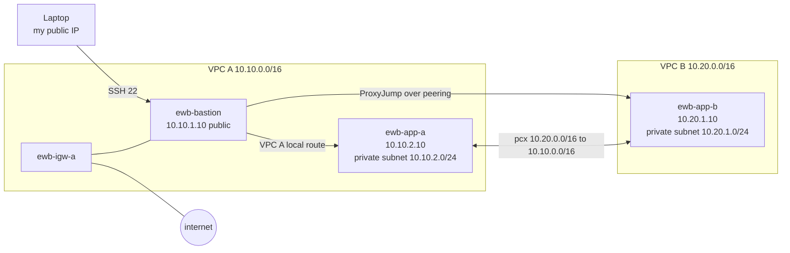

# AWS VPC Peering — private traffic between two VPCs

**Student:** Baibhav Raj · **Course:** EWB Cloud Labs, AWS Architect Associate · **Project 01**
**Region:** ap-south-1 (Mumbai) · **Built:** 17 October 2026 · **Status:** all six tests passed

Two VPCs that know nothing about each other, then one peering connection that makes them talk over
private IPs only. I built the whole thing from the AWS CLI, ran every test the workbook asks for,
kept the raw terminal output, and broke it on purpose at the end to prove which rule actually matters.

```
Your laptop ──SSH 22──► ewb-bastion 10.10.1.10 ─┬─► ewb-app-a 10.10.2.10   (VPC A local route)
   (public IPv4, my IP only)                    └─► ewb-app-b 10.20.1.10   (through pcx)
                                                ▲
                    VPC A 10.10.0.0/16          │          VPC B 10.20.0.0/16
                 ┌─────────────────────┐        │        ┌─────────────────────┐
   internet ───► │ ewb-igw-a           │        │        │ no internet gateway │
                 │                     │        │        │                     │
                 │ public  10.10.1.0/24│        │        │ private 10.20.1.0/24│
                 │  bastion 10.10.1.10 │◄───pcx─┴────────┤  App-B  10.20.1.10  │
                 │ private 10.10.2.0/24│   10.20 ─┐ ┌10.10│                     │
                 │  App-A  10.10.2.10  │          ▼ ▼     │                     │
                 └─────────────────────┘  return routes on both sides
```

Mermaid version (same picture, renders on GitHub):



## The address plan

| Resource | Where | Address |
|---|---|---|
| `ewb-vpc-a` | VPC A | 10.10.0.0/16 |
| `ewb-a-public` | VPC A | 10.10.1.0/24 |
| `ewb-a-private` | VPC A | 10.10.2.0/24 |
| `ewb-vpc-b` | VPC B | 10.20.0.0/16 |
| `ewb-b-private` | VPC B | 10.20.1.0/24 |
| `ewb-bastion` | `ewb-a-public` | 10.10.1.10 + a public IPv4 |
| `ewb-app-a` | `ewb-a-private` | 10.10.2.10, **no** public IPv4 |
| `ewb-app-b` | `ewb-b-private` | 10.20.1.10, **no** public IPv4 |

10.10.0.0/16 and 10.20.0.0/16 do not overlap, so peering is even allowed. Real IDs for everything are
in [`evidence/00-inventory.txt`](evidence/00-inventory.txt).

## Route tables (the part that actually makes it work)

| Table | Attached to | Routes |
|---|---|---|
| `ewb-rt-a-public` | `ewb-a-public` | local 10.10.0.0/16 · 0.0.0.0/0 → `ewb-igw-a` · **10.20.0.0/16 → pcx** |
| `ewb-rt-a-private` | `ewb-a-private` | local 10.10.0.0/16 · **10.20.0.0/16 → pcx** |
| `ewb-rt-b-private` | `ewb-b-private` | local 10.20.0.0/16 · **10.10.0.0/16 → pcx** (return path) |

The public subnet needs a peering route too, because ProxyJump means the **bastion** opens the
connection to App-B. The `/16` peering route is more specific than `0.0.0.0/0`, so that traffic goes
to the peering connection instead of the internet.

## Security groups

| Group | Inbound | Why that source |
|---|---|---|
| `ewb-sg-bastion` | TCP 22 from `<my public IPv4>/32` | only my laptop reaches the one public host |
| `ewb-sg-app-a` | TCP 22 from 10.10.1.10/32 · ICMP Echo (type 8, code 0) from 10.20.1.10/32 | bastion admin, App-B ping |
| `ewb-sg-app-b` | TCP 22 from 10.10.1.10/32 · ICMP Echo (type 8, code 0) from 10.10.2.10/32 | the bastion's **private** IP is the source through ProxyJump |

Nothing is open to `0.0.0.0/0`. Outbound stays allow-all and NACLs stay default, so this lab isolates
routing and security groups as the variables.

## Test results (real output, not the workbook's expectations)

| # | Test | Where | Result | Evidence |
|---|---|---|---|---|
| 01 | Baseline, before peering | App-A: `ping -c 4 10.20.1.10` | **0 received, 100% loss** | [`03-baseline-ping-app-a-to-app-b.txt`](evidence/03-baseline-ping-app-a-to-app-b.txt) |
| 02 | Forward path | App-A: `ping -c 4 10.20.1.10` | **4 received, 0% loss, avg 0.33 ms** | [`05-forward-ping-app-a-to-app-b.txt`](evidence/05-forward-ping-app-a-to-app-b.txt) |
| 03 | Reverse path | App-B: `ping -c 4 10.10.2.10` | **4 received, 0% loss** | [`06-reverse-ping-app-b-to-app-a.txt`](evidence/06-reverse-ping-app-b-to-app-a.txt) |
| 04 | Private SSH | laptop: `ssh` App-B through bastion | **shell on `ip-10-20-1-10`** | [`07-ssh-app-b-via-bastion.txt`](evidence/07-ssh-app-b-via-bastion.txt) |
| 05 | Isolation | EC2 instance details | **App-A and App-B both `public=(none)`** | [`08-private-only-check.txt`](evidence/08-private-only-check.txt) |
| 06 | Controlled failure | delete one ICMP rule, then restore | **100% loss → 4 replies again** | [`09`](evidence/09-controlled-failure-ping.txt), [`10`](evidence/10-recovered-ping.txt) |

Forward path: App-A sends to 10.20.1.10 → its subnet table matches 10.20.0.0/16 → peering connection →
App-B's ENI. Return path: App-B replies to 10.10.2.10 → `ewb-rt-b-private` matches 10.10.0.0/16 → back
over the same pcx. Remove either direction and ping dies while the pcx still reads *Active*.

The controlled failure was the useful one: I revoked only `ewb-sg-app-b`'s inbound Echo request from
10.10.2.10/32, kept the SSH rule, and ping went straight to 100% loss. Restoring the identical rule
brought back 4 replies. Routing was never the problem in that step — the security group was.

## The bug that taught me most

Peering and routes were correct, SSH to App-B worked, yet every ping failed both ways. `tcpdump` on
App-A showed the echo requests leaving; `tcpdump` on App-B showed **zero packets arriving**. The AWS
CLI shortcut `--protocol icmp --port 8` wrote the rule as **type 8, code 8**, and an echo request is
code 0 — so the hypervisor dropped the packets before the guest ever saw them. The fix was explicit
`--ip-permissions "IpProtocol=icmp,FromPort=8,ToPort=0,..."`. A console click on *Custom ICMP - IPv4 /
Echo request* would have given me type 8 code 0 from the start. Two lessons: a peering route being
present is not the same as traffic being permitted, and one packet capture on each side tells you
which side is lying.

## How to run it yourself

```bash
aws --version                    # needs AWS CLI v2 + credentials, ssh, curl, python
./build-lab.sh all               # keypair -> network -> instances -> baseline -> peering -> verify
./build-lab.sh failtest          # controlled failure and recovery
./build-lab.sh status            # inventory of whatever exists now
./build-lab.sh teardown          # delete everything this script made
```

Each phase is a separate command so you can capture the checkpoint screenshots the workbook asks for.
`state.env` remembers the real IDs; every phase is safe to re-run — it finds a resource by its `Name`
tag before creating a duplicate. `AZ`, `REGION`, `INSTANCE_TYPE` and `MY_IP` are all overridable
environment variables (for example `MY_IP=203.0.113.9 ./build-lab.sh network`).

Costs: 3 × `t3.micro` + one public IPv4 + 8 GB `gp3` root volumes, all delete-on-termination, in one
AZ. Nothing else in the account was touched, and the lab needs no NAT gateway. On-demand that is about
$0.08 per hour (₹7), so keep it running only while you test. **Teardown when you are done.**

Admin access without moving keys: `./build-lab.sh sshconfig` writes `ssh_config.snippet` and puts the
key at `~/.ssh/ewb-lab.pem` (mode 400). The private key never goes onto an instance and is not in this
repo — `secrets/` is git-ignored.

## Viva answers

1. **Why the return route?** A ping is two trips. The request reaches App-B over the pcx; the reply
   is a new lookup in VPC B's table, which only knows its own local range until you add
   10.10.0.0/16 → pcx. One-way routes give 100% loss with an *Active* connection.
2. **Why is App-B's SSH source the bastion's private IP?** The packet's source is whatever the
   bastion sends it as, which is its primary private IP 10.10.1.10. My laptop's public IP is
   terminated at the bastion; it never crosses the peering connection.
3. **Why doesn't *Active* peering guarantee a ping?** The pcx is only the link. Whether traffic may
   use it is decided by route tables on both sides, security groups (both directions and the right
   ICMP code), NACLs, and whether the hosts are running.
4. **Can VPC B use VPC A's internet gateway over peering?** No. Transitive routing to an IGW is not
   supported — an IGW serves the VPC it is attached to, and VPC B has no default route to anything
   that reaches the internet. That is why the instances in VPC B cannot `dnf update`, and why that
   failure is not a peering bug.

Peering is also one-to-one and non-transitive: A–B plus A–C never gives B–C.

## Files

| File | What it is |
|---|---|
| `build-lab.sh` | the whole lab: build, test, break, clean up |
| `evidence/` | raw terminal output and route/SG dumps, one file per test |
| `ssh_config.snippet` | the ProxyJump config, generated with real values |
| `state.env` | local only (git-ignored): resource IDs for teardown |
| `secrets/` | local only (git-ignored): private key, never committed |
| [`REPORT.md`](REPORT.md) | submission checklist mapped to the marking scheme |

## References

* [VPC peering concepts and limitations](https://docs.aws.amazon.com/vpc/latest/peering/what-is-vpc-peering.html)
* [Create a VPC peering connection](https://docs.aws.amazon.com/vpc/latest/peering/create-vpc-peering-connection.html)
* [Update route tables for peering](https://docs.aws.amazon.com/vpc/latest/peering/peering-update-route-table.html)
* [Security groups for peered VPCs](https://docs.aws.amazon.com/vpc/latest/peering/peering-security-groups.html)
* [EC2 key pair security](https://docs.aws.amazon.com/AWSEC2/latest/UserGuide/ec2-key-pairs.html)
* [Amazon VPC pricing](https://aws.amazon.com/vpc/pricing/)
